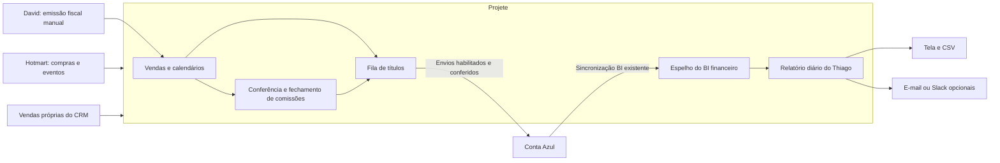

# Financeiro integrado — operação e ativação

A Projete integra vendas próprias e Hotmart, forma recebíveis, apura comissões e consolida contas a pagar/receber da Conta Azul. A emissão fiscal permanece manual.



## Preparação do ambiente

1. Aplicar `migrations/20261105_financeiro_integrado.sql` no banco do ambiente, antes de publicar o módulo. Em `web/`, com as variáveis do ambiente definidas, `npm run db:finance:migrate` aplica a migração aditiva.
2. Publicar a versão que contém `/financeiro/operacao`, na aba **Vendas, comissões e relatório** do financeiro existente. Acesso: `diretoria`, `admin`, `gestor_financeiro`. O gestor comercial continua restrito à sua área.
3. Conectar a Conta Azul no menu existente. Em Financeiro → Integrações, carregar as opções, conferir a empresa e escolher conta financeira/categorias. A identificação da empresa fica vinculada à operação; trocar a empresa bloqueia a sincronização para não misturar CNPJs.
4. Importar vendas Projete e usar **Atualizar do BI** para copiar o espelho Conta Azul existente, incluindo lançamentos manuais. Concluir antes a sincronização do BI. Conferir clientes e calendários; vincular títulos já existentes. Os envios começam desabilitados.
5. Habilitar envios somente após essa conferência. A operação cria títulos; não executa pagamentos bancários nem envia novas cobranças aos alunos.

`DATABASE_SSL=disable` é uma opção explícita para PostgreSQL local sem TLS. O comportamento padrão para bancos hospedados permanece igual ao existente.

## Hotmart

Configurar no servidor `HOTMART_CLIENT_ID`, `HOTMART_CLIENT_SECRET`, `HOTMART_BASIC` e `HOTMART_HOTTOK`. São as credenciais fornecidas por Wallace/Tito; não vão para a interface nem para logs.

`HOTMART_PRODUCT_IDS` deve conter apenas IDs dos produtos desta operação, separados por vírgula. O histórico e o webhook ficam bloqueados sem essa lista. O conector não importa indiscriminadamente a conta master.

Endpoint público autenticado pelo cabeçalho `X-HOTMART-HOTTOK`:

```text
POST /api/integrations/hotmart/webhook
```

Configurar os eventos de compra na Hotmart: aprovação, conclusão, atraso, cancelamento, reembolso e chargeback. Cada transação é preservada por seu identificador, e cada evento é deduplicado. Eventos antigos não sobrescrevem versões mais novas; venda estornada não é reativada por uma aprovação posterior.

Inicialmente as compras entram em conferência. Após descobrir a modalidade e validar uma amostra real, configurar a regra do produto em Integrações → Calendários automáticos Hotmart. A regra define pagamento único, valor total parcelado ou ciclo de assinatura, número de parcelas e prazo entre aprovação e primeiro vencimento. O valor da transação deve corresponder ao valor a registrar no financeiro. Não usar uma regra de valor total em uma transação que represente apenas uma parcela.

Compras aprovadas e reimportações elegíveis passam então a formar o calendário automaticamente, uma única vez. Produtos sem regra continuam em conferência. Cada renovação de assinatura gera somente seu ciclo. Não há previsão inventada de renovações futuras.

Pagamento do comprador na Hotmart não é uma baixa bancária. Os realizados do relatório vêm das baixas detalhadas da Conta Azul. Taxas, comissões e repasses exigem conferência; o conector não lança automaticamente uma despesa estimada de taxa.

O histórico usa os filtros de status individualmente e percorre todos os cursores. O intervalo é por data do pedido; reembolsos antigos são recuperados por webhook ou por reimportação de um período que inclua a venda original.

## Vendas Projete e calendários

Importar vendas fechadas do CRM preserva os responsáveis e os valores calculados nas regras comerciais existentes. Não altera o CRM nem distribui leads. Os papéis de consultor e gestor/closer ficam separados, mesmo quando pertencem à mesma pessoa. Fundo comercial continua no fluxo original e não vira conta a pagar individual.

O calendário exige a quantidade e a data real do primeiro vencimento. O total é dividido em centavos inteiros, e os vencimentos no fim do mês são ajustados sem deslocar os meses seguintes. Um calendário confirmado não pode ser reconstruído silenciosamente; ajustes devem ser conciliados com os títulos existentes.

Antes de criar um título, o conector verifica se há uma parcela com a mesma pessoa, valor e vencimento no ERP. Nesse caso, exige conferência/vínculo para impedir duplicação de lançamentos manuais.

## Comissões

1. Conferir a comissão e identificar seu beneficiário. O histórico Hotmart é enriquecido pelo endpoint oficial de comissões; recebemos valores efetivos e identificadores dos participantes. Em Comissões → Vincular vendedor Hotmart, relacionar o identificador/origem ao vendedor da Projete. É possível registrar uma comissão faltante com valor e evidência explícitos quando a venda interna por link não corresponder a uma comissão de afiliado fornecida pela Hotmart.
2. Marcar quando a Hotmart já faz o pagamento direto. Esses itens não geram um segundo pagamento na Conta Azul.
3. Liberar com data não futura e evidência do evento elegível. Não inferimos que fechar a venda equivale a receber ou desembolsar.
4. Aprovar a competência encerrada. O fechamento preserva os itens aprovados, agrupa por beneficiário e cria contas a pagar para o dia 15 do mês seguinte.
5. Vincular beneficiários aos fornecedores da Conta Azul e processar os envios. Baixas posteriores do ERP atualizam a situação do pagamento.

Reaprovar a mesma competência retorna o fechamento existente. Liberações retroativas em período já fechado são bloqueadas; ajustes devem usar uma competência aberta e evidência que explique o evento original. Alterações comerciais ou estornos posteriores deixam a venda em conferência e não recalculam o fechamento aprovado. Correções de valor/beneficiário em comissões ainda abertas revogam a liberação anterior e exigem nova conferência. Comissões removidas ou de vendas reabertas são anuladas enquanto não aprovadas; títulos locais pendentes são cancelados. Títulos já enviados e fechamentos aprovados exigem ajustes conciliados no ERP.

## Relatório do Thiago

O relatório diário inclui vencimentos do dia, vencidos, próximos sete dias e pagamentos/recebimentos realizados por data da baixa. Lançamentos manuais e despesas da Conta Azul entram no mesmo relatório. Previsões locais sem vínculo são mostradas à parte; não entram nos totais confirmados do ERP.

O relatório reutiliza as tabelas da sincronização Conta Azul já existente no BI; não abre uma segunda varredura da API. A cópia é bloqueada enquanto o BI sincroniza. O período de vencimentos importado e a data real da atualização da origem são visíveis; copiar novamente não torna um espelho antigo recente. Uma leitura incompleta ou com mais de 24 horas gera aviso. O relatório não é uma apuração do saldo bancário disponível.

Interface e CSV para usuários financeiros:

```text
GET /api/financeiro/report
GET /api/financeiro/report?format=csv
GET /api/financeiro/statement?id=<fechamento>&user=<beneficiário>
```

O relatório é gerado diretamente pela Projete. Não há dependência de Apps Script nem endpoint público separado para planilhas.

## Rotinas agendadas e canais

O agendador da hospedagem chama os endpoints com `Authorization: Bearer <CRON_SECRET>`. Ausência de segredo não libera acesso. A publicação do código não instala um agendador automaticamente.

| Rotina | Endpoint | Frequência inicial sugerida |
|---|---|---|
| Importação CRM/Hotmart, cópia do espelho BI e fila habilitada | `/api/cron/financeiro-sync` | A cada 15 minutos |
| Relatório diário | `/api/cron/financeiro-report` | Após a sincronização da manhã, horário de Brasília |
| Demonstrativos aprovados | `/api/cron/financeiro-statements` | Diariamente após a sincronização |

As rotas acima são aliases autenticados de tarefas fixas, compatíveis com `run-cron.sh` e os timers em `docs/infra/systemd/`. O endpoint com `?task=` continua disponível. O timer de sincronização tem timeout de 360 segundos; resultado parcial (207) é sinalizado como falha pelo executor existente.

A cópia padrão considera vencimentos de um ano atrás a um ano à frente, dentro do histórico já existente no espelho BI. Agendar a sincronização Conta Azul existente antes desta rotina; esta rotina não atualiza o provedor por conta própria. Usar `from=AAAA-MM-DD&to=AAAA-MM-DD` para recuperar outros períodos. O histórico Hotmart vai da data inicial até hoje. Uma falha parcial retorna HTTP 207 e uma lista de erros, em vez de sucesso silencioso.

E-mail reutiliza o Resend existente (`RESEND_API_KEY`, `DIGEST_FROM_EMAIL`). Selecionar o usuário financeiro ativo responsável pelo relatório e habilitar a opção na tela. Demonstrativos são enviados somente aos beneficiários ativos e com seu próprio detalhamento. Essa entrega é opcional e inicia desabilitada.

Slack é opcional: `FINANCE_SLACK_WEBHOOK_URL` e `FINANCE_SLACK_ENABLED=true`. A exportação JSON/CSV funciona sem Slack. As entregas ficam registradas por dia/canal ou fechamento/beneficiário, com prevenção de repetição e chave idempotente no provedor de e-mail.

## Relatório semanal do Philipe

O fluxo semanal existente permanece separado do relatório diário operacional. Consolida financeiro do grupo TS&CO e comercial da Projete, preserva o retrato por semana e oferece a página `/gestao/relatorio-semanal`.

- Destinatário configurado: `philipe@projetus.org` (`WEEKLY_REPORT_TO`).
- Remetente: `PROJETUS <report@projetus.org>` (`WEEKLY_REPORT_FROM`).
- Frequência: sexta-feira, **18h em America/Sao_Paulo**.
- Timer: `projetus-cron@relatorio-semanal.timer`; rota `GET /api/cron/relatorio-semanal` com Bearer `CRON_SECRET`.
- Verificação em 09/11/2026: timer ativo, execução de 06/11 concluída sem erro e retrato registrado para Philipe. Próxima execução prevista em 13/11 às 18h de Brasília.
- A prévia `?preview=1` gera HTML sem gravar nem enviar; o teste operacional não dispara outro e-mail. A chave do provedor disponível é restrita a envio, portanto não comprova entrega na caixa de entrada.

## Falhas e conciliação

- Falha definitiva: corrigir a causa e recolocar na fila pela tela.
- Resposta desconhecida, timeout de escrita ou processamento interrompido: conferir o ERP e vincular a parcela existente. Não há repetição automática cega.
- A referência externa e a nota da parcela incluem o identificador Projete. A leitura consegue recuperar o vínculo se tipo, valor, pessoa e vencimento corresponderem.
- O resultado de entrega de mensagem desconhecido não é reenviado automaticamente. Conferir o registro e o canal antes de qualquer reenvio operacional.
- Nota emitida manualmente: registrar número, data e link no recebível. Nenhuma integração fiscal paga foi adicionada.

## Validação local

Requer Node compatível com a aplicação, dependências instaladas (incluindo `tsx`) e PostgreSQL isolado para a suíte de persistência. As execuções são registradas por origem no banco, com unicidade e heartbeat, compatíveis com PgBouncer em transaction pooling; nenhuma conexão fica reservada durante chamadas externas.

```sh
cd web
npm ci
FINANCE_TEST_DATABASE_URL=postgresql://finance_test@127.0.0.1:55483/postgres npm test
npx tsc --noEmit
npm run lint
npm run build
```

Para os testes HTTP, iniciar a aplicação apontando para o banco local com o schema comercial e de usuários e acrescentar `FINANCE_TEST_BASE_URL=http://localhost:<porta>` ao comando de teste. Esses casos fazem login com usuários fictícios temporários e verificam autorização, CSRF, exportação e bloqueio de operadores inativos.

As suítes de banco recusam hosts que não sejam loopback e removem somente seus dados de teste. Sem `FINANCE_TEST_DATABASE_URL`, os testes de PostgreSQL são explicitamente ignorados. Os provedores externos são simulados na borda HTTP; não são criados títulos, notas ou mensagens reais durante a validação.
