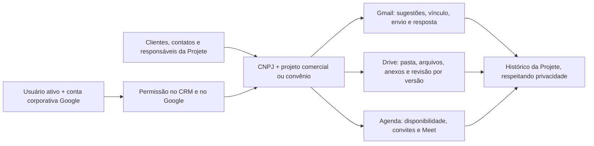

# Workspace conectado ao cliente e ao projeto

Escopo autorizado: Gmail, Drive e Agenda/Meet ligados aos clientes/CNPJs, contatos, responsáveis e projetos/convênios existentes da Projete. O primeiro percurso usa um cliente com dois projetos, pasta existente, conversa e reunião. Editores completos e chamada usam a interface oficial do Google.

## Implementação

- [x] Conexão OAuth individual com domínio verificado, estado vinculado à sessão, PKCE e tokens cifrados.
- [x] Contextos por CNPJ + registro comercial/convênio; acesso herdado do CRM.
- [x] Conversas sugeridas pelos contatos e vinculadas explicitamente ao projeto; envio e resposta pela conta conectada.
- [x] Vínculo de pasta existente, arquivos, anexos e conferência por versão do documento.
- [x] Agenda, disponibilidade, convites e Meet exclusivos vinculados ao projeto.
- [x] Área Workspace e acesso dentro da ficha atual, com histórico e pendências.
- [x] Testes de isolamento, reexecução, estados incertos, revisão documental e integração HTTP simulada.
- [x] Build e preparação da ativação.
- [ ] Publicação e migração no ambiente de produção.
- [ ] Autorização Google real por um usuário do time e aceite com um cliente real.

## Contratos

- Callback: `/api/integrations/google/callback`; o cliente OAuth deve ter exatamente essa URI registrada.
- `google_workspace_connections.user_id` identifica o usuário ativo da Projete. Uma identidade Google pode pertencer a uma única conexão; isso não altera login nem cria usuários.
- `workspace_contexts`: CNPJ normalizado e tipo/chave do registro existente. CNPJ não basta para distinguir projetos.
- Gmail e eventos vinculados permanecem privados ao titular. Documentos compartilhados exigem acesso ao cliente na Projete e ao arquivo no Google.
- Google é fonte de mensagens, arquivos e eventos. Projete mantém vínculos, revisão, autoria, histórico e regras comerciais.
- Aprovação documental registra a versão; nova versão exige nova conferência.
- Escritas com resultado desconhecido nunca são repetidas automaticamente. E-mails e convites só são enviados por ação explícita do usuário.
- Nenhuma API/URL externa é recebida do navegador; o servidor usa hosts oficiais fixos. Nenhum segredo chega à interface, ao log ou ao Git.
- A alteração local da raiz `.env.example` pertence ao usuário e contém credenciais: preservar e excluir dos commits desta entrega. Configuração executável local fica em `web/.env.local`, ignorado pelo Git.

## Referências oficiais

- https://developers.google.com/identity/protocols/oauth2/web-server
- https://developers.google.com/workspace/gmail/api/guides/threads
- https://developers.google.com/workspace/calendar/api/guides/create-events
- https://developers.google.com/workspace/drive/api/guides/enable-shareddrives
- https://developers.google.com/workspace/calendar/api/v3/reference/freebusy/query

Configuração, validação reproduzível e aceite: [google-workspace.md](../google-workspace.md).
